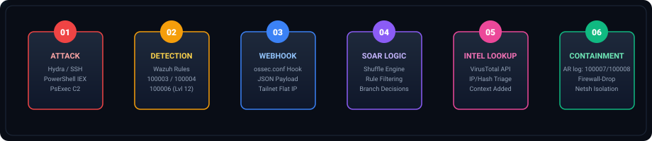
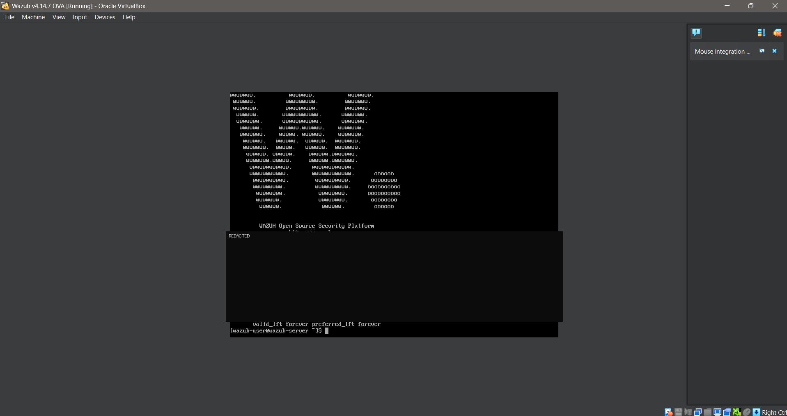
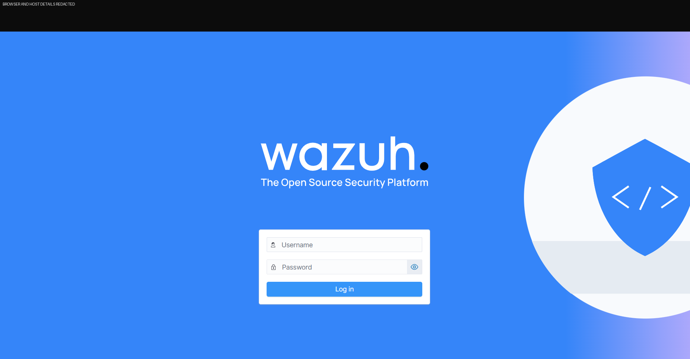
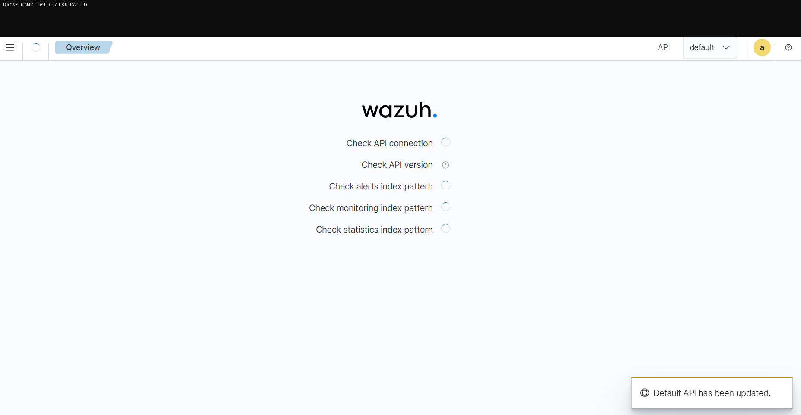
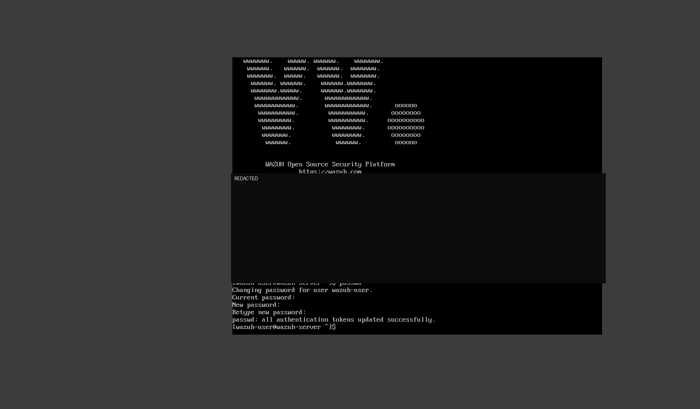
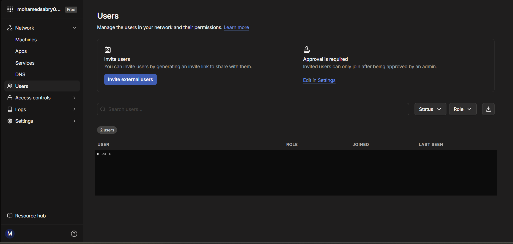
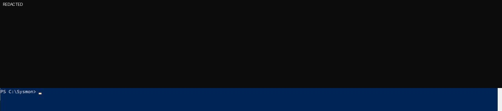
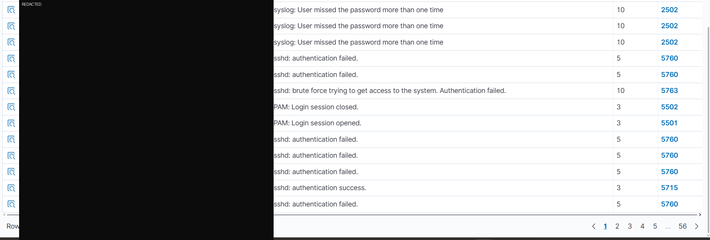
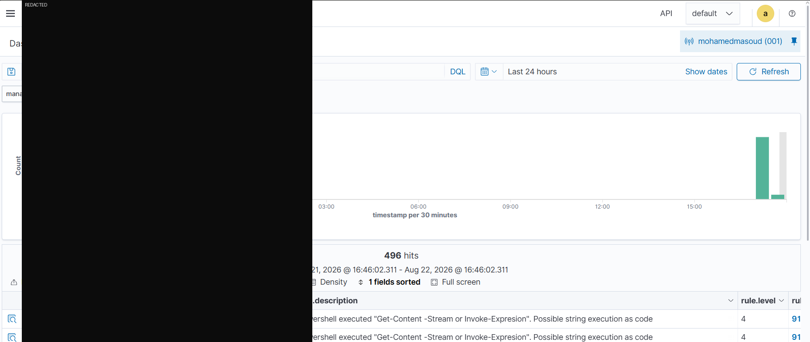
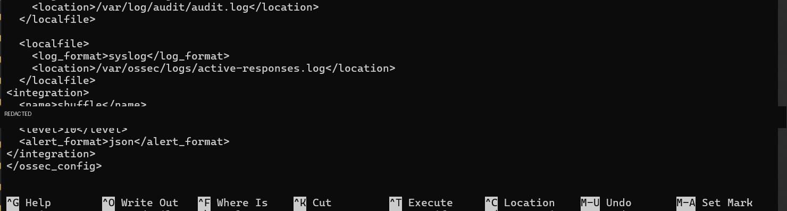

<div align="center">

  

  <br><br>

  [](https://wazuh.com/)
  [](https://shuffler.io/)
  [](https://tailscale.com/)
  [](https://www.virustotal.com/)
  [](https://attack.mitre.org/)
  [](#-automated-threat-response-pipeline)
  [](LICENSE)
  [](https://github.com/0xsabry/wazuh-shuffle-soar-soc-lab/actions/workflows/ci.yml)

  <br>

  <p align="center">
    <strong>A distributed 5-node security operations and automated incident response ecosystem.</strong><br>
    Documents a defensive lab design using zero-trust mesh networking, Wazuh detections, Shuffle enrichment, and response examples.
  </p>

  <p align="center">
    <a href="#-architecture-overview"><strong>Architecture</strong></a> •
    <a href="#-team-roles--contributions"><strong>Team Roles</strong></a> •
    <a href="#-attack-scenarios--detection-matrix"><strong>Attack Scenarios</strong></a> •
    <a href="#-soar-playbook-workflows"><strong>SOAR Playbooks</strong></a> •
    <a href="#-visual-evidence-gallery"><strong>Evidence Gallery</strong></a> •
    <a href="#-quick-start--reproduction"><strong>Quick Start</strong></a>
  </p>

</div>

---

## 📑 Table of Contents

- [Overview & Key Highlights](#-overview--key-highlights)
- [Validation Status](#-validation-status)
- [Architecture Overview](#-architecture-overview)
- [Team Roles & Contributions](#-team-roles--contributions)
- [Distributed Tailnet Mesh Topology](#-distributed-tailnet-mesh-topology)
- [Attack Scenarios & Detection Matrix](#-attack-scenarios--detection-matrix)
- [Automated Threat Response Pipeline](#-automated-threat-response-pipeline)
- [Simulated SOC Feed (animated illustration)](#-simulated-soc-feed-animated-illustration)
- [SOAR Playbook Workflows](#-soar-playbook-workflows)
- [MITRE ATT&CK Matrix](#-mitre-attck-matrix)
- [Visual Evidence Gallery](#-visual-evidence-gallery)
  - [1. Wazuh SIEM Deployment & Hardening](#1-wazuh-siem-deployment--hardening)
  - [2. Zero-Trust Tailscale Mesh Setup](#2-zero-trust-tailscale-mesh-setup)
  - [3. Endpoint Enrollment & Monitoring](#3-endpoint-enrollment--monitoring)
  - [4. Red-Team Attack Simulation](#4-red-team-attack-simulation)
  - [5. Wazuh Real-Time Threat Detections](#5-wazuh-real-time-threat-detections)
  - [6. Shuffle SOAR & VirusTotal Integration](#6-shuffle-soar--virustotal-integration)
  - [7. Active Response & Host Containment](#7-active-response--host-containment)
- [Quick Start & Reproduction](#-quick-start--reproduction)
- [Troubleshooting](docs/TROUBLESHOOTING.md)
- [Security and Public Evidence](docs/SECURITY.md)
- [Local Validation](#-local-validation)
- [Repository Structure](#-repository-structure)
- [Author & Credits](#-author--credits)

---

## 🌟 Overview & Key Highlights

This repository collects documentation, configuration examples, detection rules, SOAR workflow design, and evidence from a **5-person distributed cybersecurity operations lab**.

Instead of operating inside a single local hypervisor, our team connected **5 separate home labs and cloud instances across different physical locations** into a unified, zero-trust private network.

```
       ┌────────────────────────────────────────────────────────────────────────┐
       │                     DISTRIBUTED INCIDENT LIFECYCLE                     │
       └────────────────────────────────────────────────────────────────────────┘
            [ Red Team Simulation ] ──▶ External Attackers launch TTPs
                      │
                      ▼
            [ Monitored Endpoints ] ──▶ Linux & Windows Agents forward telemetry
                      │
                      ▼ (Encrypted WireGuard Mesh · 100.x Subnet)
            [ Wazuh SIEM Manager  ] ──▶ Real-time log decoding & rule correlation
                      │
                      ▼ (Webhook JSON Payload · latency not measured)
            [ Shuffle SOAR Engine ] ──▶ VirusTotal API lookup & decision tree
                      │
                      ▼ (Authenticated JWT Wazuh REST API)
            [ Active Containment  ] ──▶ Dynamic iptables drop & netsh host isolation
```

> The lifecycle above shows the **intended** flow. It is not a record of a validated end-to-end run — see [Validation Status](#-validation-status). In particular, no live-agent containment execution and no measured response latency are evidenced in this repository.

### Key Engineering Capabilities
- 🌐 **Zero-Trust Mesh Networking**: Replaced traditional port-forwarding with an encrypted **Tailscale WireGuard mesh** providing a flat `100.x` IPv4 space with owner-enforced device access control.
- ⚡ **Centralized SIEM Management**: Deployed **Wazuh 4.14** from an all-in-one appliance to ingest Syslog, Sysmon, Auditd, and Windows Event logs from disparate endpoints.
- 🔄 **SOAR Integration Artifacts**: Includes a Wazuh custom webhook integration and a reference Shuffle workflow design. The workflow is not a native export, and CI does not validate end-to-end orchestration.
- 🛡️ **Active-response reference artifacts**: Includes example containment configuration and scripts. The committed offline checks do not validate execution on a Wazuh agent.

---

## ✅ Validation Status

Status categories used in this repository:

- **Implemented configuration** — the file is committed and structurally valid (offline CI checks pass).
- **Offline/static validation** — checked by `scripts/validate_lab_assets.py` or unit tests without running Wazuh, Shuffle, or an agent.
- **Simulated behavior** — observed in the historical lab or shown in a scripted illustration; not reproduced from this checkout.
- **Live-agent execution** — observed running on a real enrolled agent with recoverable evidence.
- **Fully validated end-to-end** — the whole chain (detect → enrich → respond → verify) reproduced and evidenced. Nothing in this repository currently meets this bar.

| Item | Claimed status | Evidenced status | Evidence / note |
| --- | --- | --- | --- |
| Wazuh custom rules `100001`–`100008` (`configs/rules/local_rules.xml`) | Detection rules | Implemented configuration + offline/static validation | XML parses; rule IDs, ranges, and references pass CI. No `wazuh-logtest` replay is included. |
| Wazuh manager config (`configs/ossec.conf`) | Webhook + active-response bindings | Implemented configuration + offline/static validation | XML parses; integration and command references pass CI. |
| `firewall-drop` binding for rule `100003` (SSH, 600 s timeout) | Automated iptables block | Implemented configuration; live-agent execution **unverified** | Binding is configured. No `active-responses.log` or agent evidence in the repo. The committed `firewall-drop.sh` is a reference copy; no step documents deploying it to an agent's `active-response/bin`. |
| `netsh-isolate` binding for rules `100004`/`100005` (PowerShell, 1800 s timeout) | Windows host isolation | Implemented configuration; live-agent execution **unverified** | Binding is configured, but the configured executable is `netsh.cmd` while the committed script file is `netsh-isolate.cmd`. No deployment/rename step is documented and no live run is evidenced. |
| Rule `100006` (C2 service creation) containment | Automated quarantine via SOAR | Design only; **no direct active-response binding** | `ossec.conf` has no `<active-response>` stanza for `100006`. Containment would depend entirely on the Shuffle REST API callback, which is not runtime-validated. |
| Custom webhook integration (`configs/integrations/custom-shuffle`) | Alert forwarding to Shuffle | Implemented configuration + offline/static validation | Unit tests verify the original alert JSON is forwarded by the Python code. No live webhook delivery is evidenced. |
| Shuffle workflow (`configs/shuffle/soc_automated_response_workflow.json`) | Automated SOAR response | Reference design; **not runtime-validated** | JSON graph is structurally valid per CI, but it is not a native Shuffle export and was not imported or executed against a live manager in any evidenced run. |
| VirusTotal enrichment node | Automated threat-intel lookup | Design only | Node exists on the workflow canvas (gallery item 19). No live lookup result is shown. Requires a locally configured API key. |
| Wazuh REST API JWT callback | Authenticated containment trigger | Design only | Node exists on the canvas (gallery item 21) and a request-shape example is in `docs/SOAR_PLAYBOOKS.md`. No live token exchange or API call is evidenced. |
| Historical screenshot 22 (rule 651) | Host isolation proof | Simulated behavior (historical observation) | Shows built-in rule 651 ("Host Blocked by firewall-drop Active Response") with built-in SSH rules 5763/5760. Evidence of a stock `firewall-drop` event in the historical lab only — not of Windows/`netsh`, not of custom rule `100003`, and not of the committed scripts. Agent/time redacted. |
| Historical detection screenshots 15–17 | Custom-rule detections | Simulated behavior (historical observation) | Show built-in rules 5763, 91837, 92650 — not the repository rules `100003`/`100004`/`100006`. |
| Terminal animation (`assets/animations/terminal-simulation.svg`) | SOC feed | Simulated behavior (scripted illustration) | Timestamps, exec ID, and the "1.27s" outcome are written into the animation. No latency was measured. |
| Response latency (e.g. "within milliseconds", "1.27s") | Measured performance | **No evidence** | No timing measurement exists in the repository. Do not quote a latency figure. |

To reproduce or upgrade any row to live-agent execution: deploy the exact committed configs to an isolated lab, run the scenario, and keep the resulting `active-responses.log`, Shuffle execution record, and Wazuh alert — then update this table with links to that evidence.

---

## 🏗️ Architecture Overview

<div align="center">
  
</div>

### Intended Dataflow
1. **Agent Telemetry (Port 1514/TCP)**: Victim endpoints continuously stream OSSEC-encrypted audit and event logs to the central Wazuh Manager over their private Tailscale addresses (`100.64.0.10`).
2. **Alert Triggering (Rule Engine)**: Custom XML correlation rules evaluate log streams against frequency thresholds, regex patterns, and MITRE ATT&CK criteria.
3. **Webhook Dispatch (HTTP/JSON)**: `ossec-integratord` packages alerts of severity Level $\ge 6$ and dispatches JSON payloads to the Shuffle SOAR webhook listener on port `3001`.
4. **Threat Intelligence & Response Loop (intended design)**: Shuffle is designed to extract IPs and hashes, conduct VirusTotal API lookups, authenticate against the Wazuh REST API via JWT, and issue containment instructions back to the affected agent. None of these steps is evidenced as a live executed run in this repository.

---

## 👥 Team Roles & Contributions

| Member | Lab Role | Core Responsibilities | Target / Node |
| :--- | :--- | :--- | :--- |
| **Mohamed Sabry**<br>([@0xsabry](https://github.com/0xsabry)) | **Project Lead & SIEM Architect** | • Wazuh OVA manager deployment & VM hardening<br>• Custom detection rules & OSSEC configuration<br>• Webhook integration & active-response binding | `wazuh-manager`<br>`100.64.0.10` |
| **Omar Khaled** | **SOAR Automation Engineer** | • Shuffle SOAR Docker deployment & canvas design<br>• Inbound webhook listener & JSON payload parsing<br>• VirusTotal API v3 integration & JWT API callbacks | `shuffle-soar`<br>`100.64.0.14` |
| **Mohamed Massoud** | **Linux Target & Red Team** | • Ubuntu Server 24.04 LTS endpoint enrollment<br>• Nmap service recon & Hydra SSH brute-force simulation<br>• Linux `firewall-drop` iptables blocking (configuration only; live-agent execution unverified) | `ubuntu-victim`<br>`100.64.0.11` |
| **Karim** | **Windows Target & Red Team** | • Windows 11 endpoint enrollment & Sysmon integration<br>• ExecutionPolicy bypass & IEX download cradle testing<br>• Windows `netsh` host isolation (configuration only; live-agent execution unverified) | `win11-victim`<br>`100.64.0.12` |
| **Mohamed Bushnak** | **Server Target & Red Team** | • Windows Server 2022 endpoint enrollment<br>• PsExec-style remote execution & rogue service creation<br>• Windows Server C2 service containment (design only; live-agent execution unverified) | `win2022-srv`<br>`100.64.0.13` |

---

## 🌐 Distributed Tailnet Mesh Topology

```
┌────────────────────────────────────────────────────────────────────────────────────────┐
│                        PRIVATE TAILSCALE ZERO-TRUST MESH (100.64.0.0/10)               │
├────────────────────┬────────────────────┬─────────────────────┬────────────────────────┤
│ Node Name          │ Operating System   │ Assigned Tailnet IP │ Role in Pipeline       │
├────────────────────┼────────────────────┼─────────────────────┼────────────────────────┤
│ wazuh-manager      │ Linux (Debian)     │ 100.64.0.10         │ SIEM Core / Controller │
│ ubuntu-victim      │ Ubuntu 24.04 LTS   │ 100.64.0.11         │ SSH Target Endpoint    │
│ win11-victim       │ Windows 11 Ent     │ 100.64.0.12         │ PowerShell Target      │
│ win2022-srv        │ Windows Server '22 │ 100.64.0.13         │ C2 / Service Target    │
│ shuffle-soar       │ Linux (Docker)     │ 100.64.0.14         │ SOAR Orchestration Hub │
└────────────────────┴────────────────────┴─────────────────────┴────────────────────────┘
```

> [!NOTE]
> All attacker workstations were hosted in local, un-routed subnets outside the Tailscale mesh to maintain authentic offensive-to-defensive boundaries.

---

## 🎯 Attack Scenarios & Detection Matrix

The rules below are intended examples, not runtime-verified detections. Offline CI checks structure only.

| Scenario | Local rule IDs | Intended response | Runtime status |
| --- | --- | --- | --- |
| SSH brute force | `100001`–`100003` (with built-in parent `5710`) | `firewall-drop` | Unverified on a live agent |
| PowerShell activity | `100004`–`100005` | Windows response design | Unverified on a live agent |
| Service creation | `100006` | Windows response design | Unverified on a live agent |

### Scenario 1: SSH Brute-Force Credential Attack (Ubuntu)
The scenario descriptions below are reference examples from the lab. The current branch has not reproduced each detection or containment outcome end to end.
- **Vector**: Remote SSH password spraying using `hydra` and `rockyou.txt`.
- **Detection (intended)**: Log decoders are designed to match repeated authentication failures within a 120-second sliding window, triggering Rule `100003` (*Maximum authentication attempts exceeded*). The historical screenshots show built-in rules `5760`/`5763` instead; firing of `100003` is not evidenced.
- **Mitigation (intended, unverified on a live agent)**: `ossec.conf` binds rule `100003` to the `firewall-drop` active-response command, which is designed to write an `iptables` drop rule for the attacker's IP. No live-agent execution of this binding is evidenced in this repository.

### Scenario 2: Suspicious PowerShell Download Cradle (Windows 11)
- **Vector**: Execution policy bypass paired with an in-memory `IEX (New-Object Net.WebClient).DownloadString(...)` payload cradle.
- **Detection (intended)**: Script Block Logging (Event 4104) is designed to capture the command, triggering Rule `100004` (*Suspicious PowerShell string execution*). The historical screenshot shows built-in rule `91837` instead; firing of `100004` is not evidenced.
- **Mitigation (intended, unverified on a live agent)**: `ossec.conf` binds rules `100004`/`100005` to the `netsh-isolate` active-response command, designed to place the host network stack into isolated quarantine. No live-agent execution of this binding is evidenced in this repository, and the configured executable name (`netsh.cmd`) does not match the committed script file (`netsh-isolate.cmd`) — see [Validation Status](#-validation-status).

### Scenario 3: C2 / Remote Service Creation (Windows Server 2022)
- **Vector**: PsExec-style lateral execution installing a persistence service (`sc.exe create ...`).
- **Detection (intended)**: Windows System Event 7045 is designed to trigger Rule `100006` (*New Windows Service Created - Severity Level 12*). The historical screenshot shows built-in rule `92650` instead; firing of `100006` is not evidenced.
- **Mitigation (intended, unverified on a live agent)**: the Shuffle playbook design routes rule `100006` alerts through VirusTotal enrichment and a Wazuh REST API callback to trigger active response. No live end-to-end execution — no host quarantine and no analyst notification from a live run — is evidenced in this repository. Rule `100006` also has no direct active-response binding in `configs/ossec.conf`; containment for this scenario depends entirely on the unvalidated API callback path.

---

## ⚡ Automated Threat Response Pipeline

<div align="center">
  
</div>

---

## 🎬 Simulated SOC Feed (animated illustration)

<div align="center">
  
</div>

> The terminal above is a scripted animation, not a recorded log. Its timestamps, execution ID, and "1.27s" outcome are illustrative values written into the animation; no response latency was measured and no live containment run is shown.

---

## 🔄 SOAR Playbook Workflows

The workflow diagram below describes the intended multi-stage Shuffle design. The committed JSON is not a native Shuffle export and its runtime nodes are not validated by CI:

```
                      ┌─────────────────────────────────┐
                      │ Inbound Webhook Listener (JSON) │
                      └────────────────┬────────────────┘
                                       │
                                       ▼
                      ┌─────────────────────────────────┐
                      │   Field Parser & Normalizer     │
                      └────────────────┬────────────────┘
                                       │
                    ┌──────────────────┴──────────────────┐
                    │                                     │
           [ Rule == 100003 (SSH) ]               [ Rule == 100004 / 100006 ]
                    │                                     │
                    ▼                                     ▼
        ┌───────────────────────┐             ┌───────────────────────┐
        │ Direct Active-Response│             │ VirusTotal API v3     │
        │ Command Initiation    │             │ Threat Intelligence   │
        └───────────┬───────────┘             └───────────┬───────────┘
                    │                                     │
                    └──────────────────┬──────────────────┘
                                       │
                                       ▼
                      ┌─────────────────────────────────┐
                      │ Wazuh REST API JWT Auth (55000) │
                      └────────────────┬────────────────┘
                                       │
                                       ▼
                      ┌─────────────────────────────────┐
                      │ Active Response Containment Run │
                      └─────────────────────────────────┘
```

1. **Webhook Ingestion (intended)**: Wazuh is configured to push alert JSON containing Rule ID, Timestamp, Agent ID, Source IP, and Raw Log.
2. **Dynamic Branching (intended)**: Rules are classified into direct containment (e.g. active brute-force) or enrichment paths.
3. **Intel Enrichment (intended)**: VirusTotal checks the reputation of external IPs and file hashes.
4. **Authenticated Callback (intended)**: Shuffle generates a bearer JWT via `/security/user/authenticate` and calls `/active-response` on the Wazuh Manager.
5. **Auditable Logging (intended)**: A live run would preserve execution records in Shuffle execution logs and Wazuh `active-responses.log`. No such live execution log is included in this repository.

---

## 🗺️ MITRE ATT&CK Matrix

| Tactic | Technique ID | Technique Name | Detection Rule | Lab Scenario |
| :--- | :--- | :--- | :--- | :--- |
| **Initial Access** | `T1110.001` | Password Guessing | Wazuh Rule `5710` / `100003` | Hydra SSH Attack (Ubuntu) |
| **Credential Access** | `T1110.003` | Password Spraying | Wazuh Rule `100003` | Hydra SSH Attack (Ubuntu) |
| **Execution** | `T1059.001` | PowerShell Scripting | Wazuh Rule `100004` | Download Cradle (Win 11) |
| **Defense Evasion** | `T1562.001` | Disable or Modify Tools | Wazuh Rule `100005` | ExecutionPolicy Bypass |
| **Persistence** | `T1543.003` | Windows Service Creation | Wazuh Rule `100006` | PsExec Service Install |
| **Lateral Movement** | `T1021.002` | SMB / Windows Admin Shares | Wazuh Rule `100006` | Remote Service Execution |
| **Command & Control** | `T1071.001` | Web Protocols (HTTP C2) | VirusTotal Integration | Payload Fetch & Beaconing |

---

## 📸 Visual Evidence Gallery

These are historical screenshots from the lab. They document what was observed in that environment; they do not prove that the current committed configurations reproduce each result. The repository's automated checks are offline structural checks only.

### 1. Wazuh SIEM Deployment & Hardening
<table>
  <tr>
    <td width="50%" align="center">
      <br>
      <sub><strong>01 · Appliance Deployment</strong><br>Importing the official Wazuh all-in-one OVA (v4.14) into VirtualBox.</sub>
    </td>
    <td width="50%" align="center">
      <br>
      <sub><strong>02 · Web Console Authentication</strong><br>Initial administrative login into the Wazuh WUI dashboard.</sub>
    </td>
  </tr>
  <tr>
    <td align="center">
      <br>
      <sub><strong>03 · Operational Dashboard</strong><br>Wazuh security overview confirming active manager services.</sub>
    </td>
    <td align="center">
      <br>
      <sub><strong>04 · Security Hardening</strong><br>Rotating default administrative credentials on first deployment.</sub>
    </td>
  </tr>
</table>

---

### 2. Zero-Trust Tailscale Mesh Setup
<table>
  <tr>
    <td width="50%" align="center">
      <br>
      <sub><strong>05 · Zero-Trust Device Onboarding</strong><br>Owner-approved Tailscale mesh invites distributed to lab contributors.</sub>
    </td>
    <td width="50%" align="center">
      <br>
      <sub><strong>06 · Connected Tailnet Mesh</strong><br>All 5 distributed machines online and reachable on flat 100.x subnet.</sub>
    </td>
  </tr>
</table>

---

### 3. Endpoint Enrollment & Monitoring
<table>
  <tr>
    <td width="50%" align="center">
      <br>
      <sub><strong>07 · Windows 11 Agent Enrollment</strong><br>Registering Karim's Windows endpoint against manager Tailscale IP.</sub>
    </td>
    <td width="50%" align="center">
      <br>
      <sub><strong>08 · Windows Server 2022 Enrollment</strong><br>Enrolling Mohamed Bushnak's Windows Server target machine.</sub>
    </td>
  </tr>
  <tr>
    <td align="center">
      <br>
      <sub><strong>09 · Windows Agent Configuration</strong><br>Configuring server address and secure registration parameters.</sub>
    </td>
    <td align="center">
      <br>
      <sub><strong>10 · Agent Telemetry in Threat Hunting (historical screenshot)</strong><br>Filtering events from agent 'karim' in Wazuh Threat Hunting.</sub>
    </td>
  </tr>
</table>

---

### 4. Red-Team Attack Simulation
<table>
  <tr>
    <td width="50%" align="center">
      <br>
      <sub><strong>11 · SSH Reconnaissance (Massoud Target)</strong><br>Nmap service scanning identifying open SSH daemon on Ubuntu.</sub>
    </td>
    <td width="50%" align="center">
      <br>
      <sub><strong>12 · Hydra Brute-Force Attack</strong><br>High-speed dictionary attack guessing SSH credentials on victim host.</sub>
    </td>
  </tr>
  <tr>
    <td align="center">
      <br>
      <sub><strong>13 · PowerShell ExecutionPolicy Bypass</strong><br>Bypassing script restrictions on Windows 11 endpoint (Karim).</sub>
    </td>
    <td align="center">
      <br>
      <sub><strong>14 · In-Memory Download Cradle</strong><br>IEX / DownloadString cradle triggering remote malicious payload fetch.</sub>
    </td>
  </tr>
</table>

---

### 5. Wazuh Real-Time Threat Detections
<table>
  <tr>
    <td width="50%" align="center">
      <br>
      <sub><strong>15 · SSH Brute Force Detection</strong><br>Historical screenshot shows built-in rule 5763; the repository rule is now 100003 and needs runtime validation.</sub>
    </td>
    <td width="50%" align="center">
      <br>
      <sub><strong>16 · Suspicious PowerShell Detection</strong><br>Historical screenshot shows built-in rule 91837; the repository rule is now 100004 and needs runtime validation.</sub>
    </td>
  </tr>
  <tr>
    <td colspan="2" align="center">
      <br>
      <sub><strong>17 · Command & Control Service Creation Detection</strong><br>Historical screenshot shows built-in rule 92650; the repository rule is now 100006 and needs runtime validation.</sub>
    </td>
  </tr>
</table>

---

### 6. Shuffle SOAR & VirusTotal Integration
<table>
  <tr>
    <td width="50%" align="center">
      <br>
      <sub><strong>18 · Complete SOAR Playbook Canvas</strong><br>Shuffle workflow designed by Omar Khaled with branching logic.</sub>
    </td>
    <td width="50%" align="center">
      <br>
      <sub><strong>19 · VirusTotal Threat Intel Node (workflow canvas, design view)</strong><br>VirusTotal reputation-lookup node as drawn in the playbook canvas. No live lookup result is shown.</sub>
    </td>
  </tr>
  <tr>
    <td align="center">
      <br>
      <sub><strong>20 · Wazuh Webhook Integration Block</strong><br>Configuration in ossec.conf routing qualifying rules to Shuffle.</sub>
    </td>
    <td align="center">
      <br>
      <sub><strong>21 · Wazuh REST API Authentication (workflow canvas, design view)</strong><br>JWT authentication node as drawn in the playbook canvas. No live token exchange is shown.</sub>
    </td>
  </tr>
</table>

---

### 7. Active Response & Host Containment (historical evidence only)
<div align="center">
  <br>
  <sub><strong>22 · Historical firewall-drop Active-Response Event (Linux SSH brute force)</strong><br>Historical Threat Hunting screenshot. What it actually shows: built-in rule <strong>651</strong> ("Host Blocked by firewall-drop Active Response") above built-in SSH alerts — rule <strong>5763</strong> (SSH brute-force attempt) and repeated rule <strong>5760</strong> (SSH authentication failed). It is evidence that a stock <code>firewall-drop</code> active-response event was logged in the historical lab for an SSH brute-force sequence. It does <strong>not</strong> show Windows, <code>netsh</code>, PowerShell, or script execution; it does not show the committed custom rules (<code>100003</code>) or the committed scripts (<code>firewall-drop.sh</code>, <code>netsh-isolate.cmd</code>) running; and the agent name, timestamp, and source details are redacted, so no host, time, or latency can be verified from it. The image is preserved unchanged as historical evidence.</sub>
</div>

---

## 🚀 Quick Start & Reproduction

### 1. Clone the Repository
```bash
git clone https://github.com/0xsabry/wazuh-shuffle-soar-soc-lab.git
cd wazuh-shuffle-soar-soc-lab
```

### 2. Run the offline validation
See [Local Validation](#local-validation) for the standard-library checks. They
do not start or contact any lab services.

### 3. Review Sanitized Configurations
- **Wazuh Manager Config**: [`configs/ossec.conf`](configs/ossec.conf)
- **Custom Detection Rules**: [`configs/rules/local_rules.xml`](configs/rules/local_rules.xml)
- **Shuffle SOAR Playbook**: [`configs/shuffle/soc_automated_response_workflow.json`](configs/shuffle/soc_automated_response_workflow.json)
- **Containment Scripts**: [`configs/scripts/`](configs/scripts/)

### 4. Deploy the Lab
Follow our comprehensive step-by-step guides in the `docs/` directory:
- [📖 Full Architecture Guide](docs/ARCHITECTURE.md)
- [📖 Attack Execution Playbooks](docs/ATTACK_SCENARIOS.md)
- [📖 Detection Engineering & MITRE Mapping](docs/DETECTION_ENGINEERING.md)
- [📖 SOAR Automation & Playbooks](docs/SOAR_PLAYBOOKS.md)
- [📖 Complete Lab Setup Guide](docs/LAB_SETUP_GUIDE.md)
- [🧭 Troubleshooting Runbook](docs/TROUBLESHOOTING.md)

---

## 🧪 Local Validation

Run the offline structural checks before changing configuration assets:

```bash
python scripts/validate_lab_assets.py
python -m unittest discover -s tests -v
```

These checks validate XML/SVG syntax, the Wazuh 4.14 auth-option allowlist,
custom rule ID range and references, required custom integration files, and
workflow graph references. Unit tests also verify that the custom Shuffle
integration forwards the original alert JSON. They do not execute Wazuh,
import the workflow into Shuffle, or verify a live alert or containment.

---

## 📂 Repository Structure

```text
.
├── .github/
│   └── workflows/
│       └── ci.yml                         # Offline asset validation and tests
├── assets/
│   ├── animations/
│   │   ├── banner-animated.svg            # Animated cyber SOC header banner
│   │   ├── architecture-flow.svg          # Animated network architecture diagram
│   │   ├── threat-response-loop.svg       # Animated 6-stage response pipeline
│   │   └── terminal-simulation.svg        # Scripted simulated SOC terminal animation (illustration only)
│   └── images/                            # Categorized high-resolution evidence gallery
│       ├── 01_wazuh_manager_deployment/
│       ├── 02_tailscale_mesh_network/
│       ├── 03_agent_enrollments/
│       ├── 04_attack_simulations/
│       ├── 05_wazuh_detections/
│       ├── 06_shuffle_soar_automation/
│       └── 07_active_response_containment/
├── configs/
│   ├── ossec.conf                         # Wazuh Manager config with Shuffle Webhook
│   ├── rules/
│   │   └── local_rules.xml                # Custom SSH, PowerShell, and C2 rules
│   ├── shuffle/
│   │   └── soc_automated_response_workflow.json # Reference Shuffle workflow design (not a native export)
│   └── scripts/
│       ├── firewall-drop.sh               # Linux iptables Active Response script
│       └── netsh-isolate.cmd              # Windows firewall isolation script
├── docs/
│   ├── ARCHITECTURE.md                    # In-depth architectural documentation
│   ├── ATTACK_SCENARIOS.md                # Offensive simulation playbooks
│   ├── DETECTION_ENGINEERING.md           # Rule correlation & MITRE mapping
│   ├── SOAR_PLAYBOOKS.md                  # Shuffle automation & JWT API guide
│   ├── LAB_SETUP_GUIDE.md                 # Lab deployment instructions
│   └── TROUBLESHOOTING.md                 # Event-path diagnostics and safe triage
├── .gitignore                             # Git ignore rules
├── LICENSE                                # MIT Open Source License
├── CONTRIBUTING.md                        # Contribution guidelines
├── SECURITY.md                            # Responsible disclosure policy
└── README.md                              # Flagship repository documentation
```

---

## 👨‍💻 Author & Credits

**Mohamed Sabry Hamdan** · Cybersecurity Analyst | SOC | Incident Response | DFIR | Detection
- 🐙 GitHub: [@0xsabry](https://github.com/0xsabry)
- 💼 LinkedIn: [Mohamed Sabry](https://www.linkedin.com/in/mohamed-sabry-hamdan/)
- 📧 Email: `mohamedsabry01144@gmail.com`

### Team Contributors
- **Omar Khaled** — Shuffle SOAR Automation & Workflow Architecture
- **Mohamed Massoud** — Linux Monitored Target & SSH Brute-Force Simulation
- **Karim** — Windows Monitored Target & PowerShell Payload Simulation
- **Mohamed Bushnak** — Windows Server Target & C2 Service Creation Simulation

---

<div align="center">
  <sub>Built with pride for academic research & cybersecurity portfolio excellence · August 2026</sub><br>
  <sub>⭐ If you find this project helpful, please consider giving it a star on GitHub! ⭐</sub>
</div>
