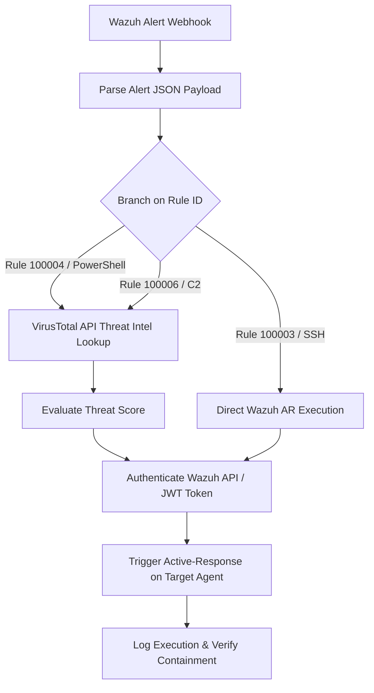

# SOAR Playbooks & Automation Workflows

Technical breakdown of Shuffle SOAR workflow pipelines, API authentication flows, and automated containment actions.

---

## 1. Playbook Workflow Architecture

The intended design uses Shuffle to receive Wazuh alerts by webhook and orchestrate enrichment and response decisions. Configure and verify the native workflow in the installed Shuffle version; the committed JSON is a reference graph only. For the evidenced status of each step, see the [Validation Status](../README.md#-validation-status) table in the README — no step below is a record of a live executed run.



---

## 2. Inbound Webhook Payload Schema

When a qualifying rule triggers, Wazuh posts the following structured JSON to Shuffle:

```json
{
  "timestamp": "2026-08-24T00:50:31.142+0000",
  "rule": {
    "level": 10,
    "description": "sshd: Maximum authentication attempts exceeded",
    "id": "100003",
    "mitre": {
      "id": ["T1110.001"]
    }
  },
  "agent": {
    "id": "002",
    "name": "agent-demo",
    "ip": "100.64.0.11"
  },
  "data": {
    "srcip": "192.0.2.10",
    "dstuser": "user-demo",
    "protocol": "ssh"
  }
}
```

---

## 3. Threat Intel Enrichment: VirusTotal API v3

For suspicious payloads, script blocks, or external domains/IPs, Shuffle executes an automated lookup via VirusTotal API:

- **Endpoint**: `https://www.virustotal.com/api/v3/ip_addresses/{ip}`
- **Header**: `x-apikey: ${VIRUSTOTAL_API_KEY}`
- **Extracted Attributes**:
  - `last_analysis_stats.malicious`
  - `last_analysis_stats.suspicious`
  - `reputation`
  - `as_owner` (Autonomous System Name)

If the malicious detection threshold is $> 0$ or matches high-risk heuristics, the playbook automatically elevates the containment priority.

---

## 4. Bi-Directional Wazuh API Callback & JWT Authentication

For a live flow, configure Shuffle to make the following authenticated REST API calls to the Wazuh Manager. These request examples do not prove a running integration:

### Step 1: JWT Authentication
Set `WAZUH_API_URL`, `WAZUH_CURL_CONFIG`, `WAZUH_CA_CERT`, `WAZUH_AGENT_ID`, and `ATTACKER_IP` locally. `WAZUH_CURL_CONFIG` should point to a curl config file created by your secret manager with mode `0600` and containing the dedicated API user's `user = "<username>:<password>"` setting. This avoids placing the password in shell history or the curl process arguments. Grant that user only the required active-response permissions.

```bash
set -o pipefail
: "${WAZUH_API_URL:?set the manager API base URL}"
: "${WAZUH_CURL_CONFIG:?set the protected curl config file path}"
: "${WAZUH_CA_CERT:?set the trusted API CA certificate path}"
: "${WAZUH_AGENT_ID:?set the target agent ID}"
: "${ATTACKER_IP:?set the source IP from the alert}"

TOKEN=$(curl --config "$WAZUH_CURL_CONFIG" --fail --silent --show-error \
  --cacert "$WAZUH_CA_CERT" -X POST \
  "$WAZUH_API_URL/security/user/authenticate?raw=true")
```
With `raw=true`, the response is the token as plain text. Keep it in the shell variable; do not paste it into logs, screenshots, or workflow files.

### Step 2: Trigger Active-Response Command
```bash
curl --fail --silent --show-error --cacert "$WAZUH_CA_CERT" -X PUT \
  "$WAZUH_API_URL/active-response?agents_list=$WAZUH_AGENT_ID" \
  -H "Authorization: Bearer $TOKEN" \
  -H "Content-Type: application/json" \
  --data "$(jq -n --arg ip "$ATTACKER_IP" \
    '{command:"firewall-drop600",alert:{data:{srcip:$ip}}}')"
```

The command name and timeout must match the Wazuh manager's active-response command configuration. This API example is a request-shape reference; verify the target agent and recovery path in an isolated lab before testing containment. The repository's offline checks do not measure execution latency or validate live containment.

## Versioned references

- [Wazuh 4.14 server API: authenticate](https://documentation.wazuh.com/4.14/user-manual/api/reference.html#operation/api.controllers.security_controller.login)
- [Wazuh 4.14 server API: run an active response](https://documentation.wazuh.com/4.14/user-manual/api/reference.html#operation/api.controllers.active_response_controller.run_command)
- [Wazuh 4.14 active-response configuration](https://documentation.wazuh.com/4.14/user-manual/reference/ossec-conf/active-response.html)
